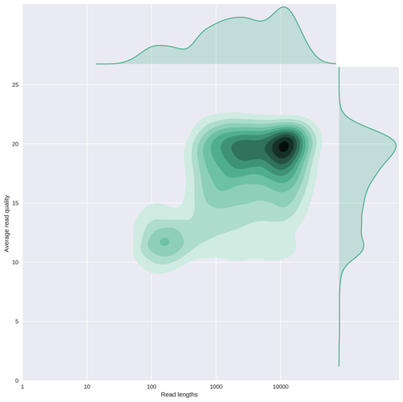
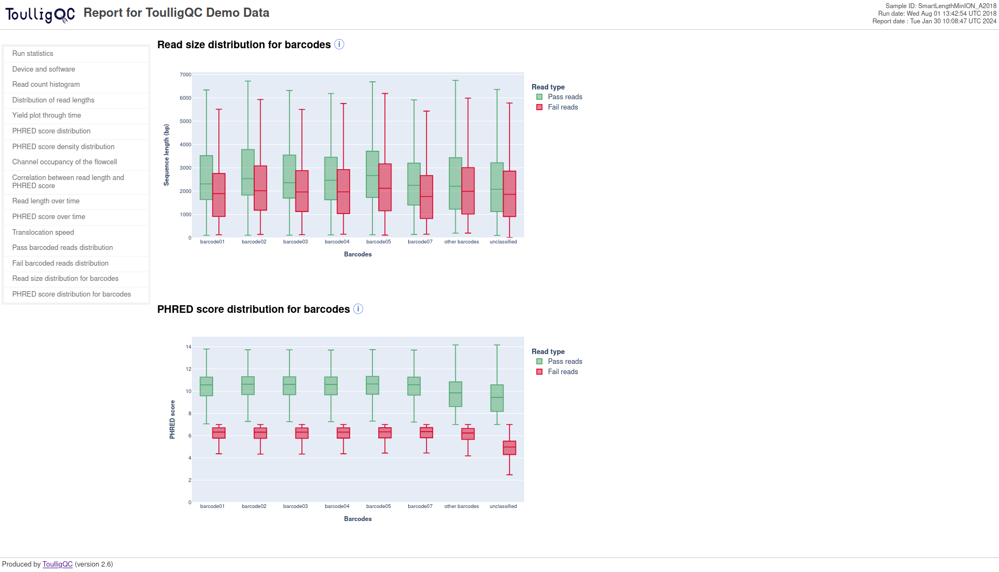
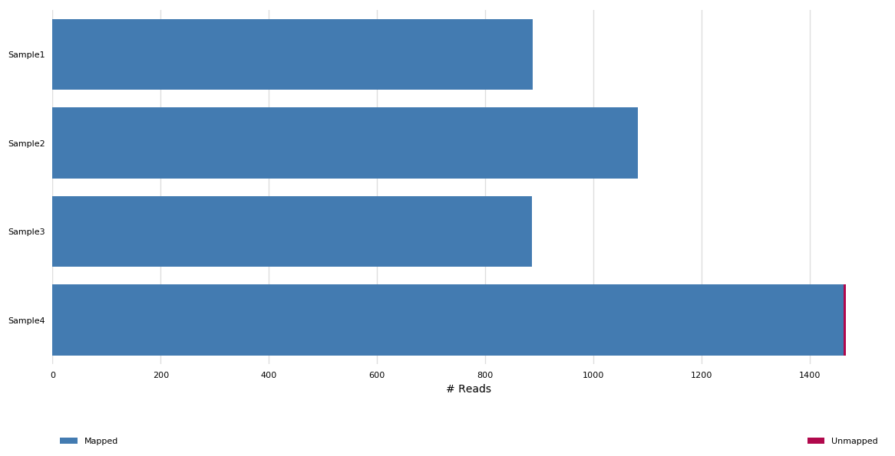

# nf-core/nanoseq: Output

## :warning: Please read this documentation on the nf-core website: [https://nf-co.re/nanoseq/output](https://nf-co.re/nanoseq/output)

## Introduction

This document describes the output produced by the nf-core/nanoseq pipeline. Most of the plots shown here are taken from the MultiQC report, which summarises the pipeline results.

## Pipeline overview

The nf-core/nanoseq pipeline is built using [Nextflow](https://www.nextflow.io/). There are many different potential outputs for the pipeline depending on what file inputs and parameters you use. Please see [`main README.md`](../README.md) for a condensed overview of the steps in the pipeline and the bioinformatics tools used at each step.

See [Oxford NanoPore website](https://nanoporetech.com/) for more information regarding the sequencing technology, protocol, and for an extensive list of additional resources.

The directories listed below are created in the output directory after the pipeline has finished. All paths are relative to the top-level results directory.

## Basecalling

Output files

- `dorado/`
  - `<SAMPLE>.basecalled.fastq.gz`: basecalled reads for each sample. Produced when basecalling is run with `--skip_demultiplexing`.
  - `undemultiplexed.basecalled.fastq.gz`: basecalled reads for all of the raw data in `--input_path`. Produced when basecalling is followed by demultiplexing with _qcat_.
  - `<SAMPLE>.basecalled.bam`: unaligned BAM file with modified base calls. Produced instead of the FASTQ file when `--bedmethyl_out` is used.
  - `<SAMPLE>.bam`: coordinate sorted BAM file of the modified base calls aligned to `--fasta` with _dorado aligner_. Produced when `--bedmethyl_out` is used.
  - `<SAMPLE>.bam.bai`: BAM index file for `<SAMPLE>.bam`.
  - `<SAMPLE>.bed.gz`: bedMethyl file with per-site modified base counts created by _modkit pileup_. Produced when `--bedmethyl_out` is used.

_Documentation_:
[dorado](https://github.com/nanoporetech/dorado), [modkit](https://github.com/nanoporetech/modkit), [pod5](https://github.com/nanoporetech/pod5-file-format)

_Description_:
Raw POD5 data is basecalled with _dorado_. FAST5 data (`--input_path_file_type fast5`) is first converted to POD5 with _pod5_. The converted POD5 files are not saved. Basecalling is skipped with `--skip_basecalling`.

When `--bedmethyl_out` is used together with `--dorado_modification`, _dorado_ calls modified bases and writes an unaligned BAM file. The pipeline aligns this BAM file to the reference with _dorado aligner_ and summarises the modified base calls per reference position with _modkit pileup_. See the [modkit documentation](https://github.com/nanoporetech/modkit#description-of-bedmethyl-output) for a description of the bedMethyl columns. The downstream read processing steps are not run for modified base calling.

## Demultiplexing

Output files

- `qcat/fastq/`
  - `barcode<NN>.fastq.gz`: FASTQ file for each barcode, for example `barcode01.fastq.gz`.
  - `none.fastq.gz`: FASTQ file with reads that were not assigned to any barcode.

_Documentation_:
[qcat](https://github.com/nanoporetech/qcat)

_Description_:
Undemultiplexed reads, either basecalled by the pipeline or provided as a FASTQ file with `--input_path`, are demultiplexed with _qcat_. Reads are assigned to samples with the `barcode` column of the samplesheet. See [`usage.md`](usage.md#introduction) for more details about the format of the input samplesheet. Demultiplexing is skipped with `--skip_demultiplexing`.

## Removal of DNA contaminants

Output files

- `nanolyse/`
  - `<SAMPLE>.fastq.gz`: FASTQ file after the removal of reads that map to DNA contaminants.
  - `<SAMPLE>.nanolyse.log`: NanoLyse log file.

_Documentation_:
[NanoLyse](https://github.com/wdecoster/nanolyse)

_Description_:
If you would like to run NanoLyse on the raw FASTQ files you can provide `--run_nanolyse` when running the pipeline. By default, the pipeline will filter lambda phage reads. However, you can provide your own FASTA file of "contaminants" with `--nanolyse_fasta`. The filtered FASTQ files contain the reads without the specified reference sequences (default: lambda phage sequences) and are used for alignment.

## Read QC

Output files

- `nanoplot/fastq/<SAMPLE>/`
  - `<SAMPLE>_NanoPlot-report.html`: _NanoPlot_ report with QC metrics and plots for each sample.
  - `<SAMPLE>_NanoStats.txt`: summary statistics for each sample.
  - `<SAMPLE>_*.html`: individual _NanoPlot_ plots, for example read length histograms and length versus quality scatter plots.
- `fastqc/`
  - `<SAMPLE>_fastqc.html`: _FastQC_ report for each sample.
  - `<SAMPLE>_fastqc.zip`: zip archive containing the _FastQC_ report, tab-delimited data file and plot images.
- `toulligqc/<SAMPLE>Toulligqc-report-<YYYY-MM-DD-HHMMSS>/`
  - `report.html`: _ToulligQC_ report that contains all the figures in a single location for each sample.
  - `report.data`: log file containing information about the _ToulligQC_ execution, environment variables and full statistics.
  - `images/`: directory containing the individual plots produced by _ToulligQC_. The plots that are produced depend on the read metadata that is available in the input.

_Documentation_:
[NanoPlot](https://github.com/wdecoster/NanoPlot), [FastQC](http://www.bioinformatics.babraham.ac.uk/projects/fastqc/Help/), [ToulligQC](https://github.com/GenomiqueENS/toulligQC)

_Description_:
_NanoPlot_ can be used to produce general quality metrics from the per sample FASTQ files e.g. quality score distribution, read lengths, and other general stats.

_FastQC_ can give general quality metrics about your reads. It can provide information about the quality score distribution across your reads, and the per-base sequence content (%A/C/G/T). You can also generate information about adapter contamination and other over-represented sequences.

_ToulligQC_ is dedicated to the QC analyses of Oxford Nanopore runs. It can be used to produce general quality metrics from the per sample FASTQ files e.g. quality score distribution, read lengths, and other general stats.

Read QC is skipped with `--skip_qc`, or for individual tools with `--skip_nanoplot`, `--skip_fastqc` and `--skip_toulligqc`.

## Alignment

Output files

- `minimap2/` or `graphmap2/`
  - `<SAMPLE>.bam`: coordinate sorted BAM file for each sample.
  - `<SAMPLE>.bam.bai`: BAM index file for each sample.
  - `<SAMPLE>.sam`: unsorted SAM file created by _GraphMap2_. Only saved when `--aligner graphmap2` and `--save_align_intermeds` are used.
  - `samtools_stats/`
    - `<SAMPLE>.flagstat`, `<SAMPLE>.idxstats` and `<SAMPLE>.stats`: alignment statistics generated by _SAMtools_.

_Documentation_:
[GraphMap2](https://github.com/lbcb-sci/graphmap2), [minimap2](https://github.com/lh3/minimap2), [SAMtools](http://www.htslib.org/doc/samtools.html)

_Description_:
Reads are mapped to the genome or transcriptome given with `--fasta` using either _minimap2_ (default) or _GraphMap2_ (`--aligner graphmap2`). The resulting BAM file is sorted and indexed using _SAMtools_. Spliced alignment is used when RNA data is aligned to a genome, i.e. when `--gtf` is provided. You can skip the alignment and downstream processes by providing the `--skip_alignment` parameter.

## Pre-aligned BAM input

Output files

- `bam/`
  - `<SAMPLE>.bam`: BAM file from the samplesheet, renamed to the sample name.
  - `<SAMPLE>.bam.bai`: BAM index file created by _SAMtools_.

_Documentation_:
[SAMtools](http://www.htslib.org/doc/samtools.html)

_Description_:
When `--skip_alignment` is used, the BAM files provided in the `input_file` column of the samplesheet are renamed to `<SAMPLE>.bam` and indexed. These files are used for transcript quantification, differential analysis and RNA modification analysis.

## Coverage tracks

Output files

- `<ALIGNER>/bigwig/`
  - `<SAMPLE>.bedGraph`: per sample coverage in bedGraph format.
  - `<SAMPLE>.bigWig`: per sample coverage in bigWig format.
- `<ALIGNER>/bigbed/`
  - `<SAMPLE>.bed`: per sample alignments in BED12 format.
  - `<SAMPLE>.bigBed`: per sample alignments in bigBed format.

_Documentation_:
[BEDTools](https://bedtools.readthedocs.io/en/latest/), [bedGraphToBigWig](https://genome.ucsc.edu/goldenpath/help/bigWig.html#Ex3), [`bedToBigBed`](https://genome.ucsc.edu/goldenPath/help/bigBed.html#Ex2)

_Description_:
The [bigWig](https://genome.ucsc.edu/goldenpath/help/bigWig.html) format is an indexed binary format useful for displaying dense, continuous data in Genome Browsers such as the [UCSC](https://genome.ucsc.edu/cgi-bin/hgTracks) and [IGV](http://software.broadinstitute.org/software/igv/). This mitigates the need to load the much larger BAM file for data visualisation purposes which will be slower and result in memory issues. The bigWig format is also supported by various bioinformatics software for downstream processing such as meta-profile plotting.

[bigBed](https://genome.ucsc.edu/goldenPath/help/bigBed.html) files are more useful for displaying the distribution of reads across exon intervals, as is typically observed for RNA-seq data.

The creation of these bigWig and bigBed files can be bypassed by setting the `--skip_bigwig` and `--skip_bigbed` parameters, respectively.

## Transcript reconstruction and quantification

Output files

If bambu is used (`--quantification_method bambu`, default):

- `bambu/`
  - `extended_annotations.gtf`: GTF file that contains both annotated and novel transcripts.
  - `counts_gene.txt`: gene expression estimates for all samples.
  - `counts_transcript.txt`: transcript expression estimates for all samples.

If StringTie2 is used (`--quantification_method stringtie2`):

- `stringtie2/`
  - `<SAMPLE>.transcripts.gtf`: per sample annotation of the transcripts assembled by _StringTie2_.
  - `<SAMPLE>.gene.abundance.txt`: per sample gene abundance estimates from _StringTie2_.
  - `<SAMPLE>.coverage.gtf`: per sample transcripts from the reference annotation that are fully covered by reads.
  - `<SAMPLE>.ballgown/`: per sample _Ballgown_ input tables (`*.ctab`).
  - `stringtie.merged.gtf`: extended annotation that combines the provided GTF with the GTF file from each sample via _StringTie2 merge_.
  - `featureCounts/`
    - `gene.featureCounts.tsv`: gene expression estimates for all samples calculated by _featureCounts_.
    - `gene.featureCounts.tsv.summary`: _featureCounts_ gene level assignment summary.
    - `transcript.featureCounts.tsv`: transcript expression estimates for all samples calculated by _featureCounts_.
    - `transcript.featureCounts.tsv.summary`: _featureCounts_ transcript level assignment summary.

_Documentation_:
[bambu](https://bioconductor.org/packages/release/bioc/html/bambu.html), [StringTie2](https://ccb.jhu.edu/software/stringtie/), [featureCounts](http://bioinf.wehi.edu.au/featureCounts/)

_Description_:
After genomic alignment of cDNA or direct RNA data, novel transcripts can be reconstructed using tools such as bambu and StringTie2. Quantification can then be performed on a more complete annotation based on the transcripts detected within a given set of samples. bambu performs both the reconstruction and quantification steps. As an alternative approach, the pipeline can run StringTie2 to identify novel transcripts. However, when multiple samples are provided, quantification for multiple samples is not implemented explicitly in the software. Hence a second step is required to merge novel transcripts across multiple samples followed by quantification for both genes and transcripts using featureCounts. You can skip transcript reconstruction and quantification by providing the `--skip_quantification` parameter.

## Differential expression analysis

Output files

- `<QUANTIFICATION_METHOD>/deseq2/deseq2.results.txt`: differential gene expression results.
- `<QUANTIFICATION_METHOD>/dexseq/dexseq.results.txt`: differential transcript usage results.

_Documentation_:
[DESeq2](https://bioconductor.org/packages/release/bioc/html/DESeq2.html), [DEXSeq](https://bioconductor.org/packages/release/bioc/html/DEXSeq.html)

_Description_:
If multiple conditions and multiple replicates are available then the pipeline is able to run differential analysis on genes and transcripts with DESeq2 and DEXSeq, respectively. `<QUANTIFICATION_METHOD>` is `bambu` or `stringtie2`. These steps won't be run if you provide the `--skip_quantification` or `--skip_differential_analysis` parameters.

## RNA modification analysis

Output files

- `rna_modifications/nanopolish/`
  - `<SAMPLE>_eventalign.txt`: per sample _nanopolish eventalign_ output with the current signal aligned to the reference.
  - `<SAMPLE>_summary.txt`: per sample _nanopolish eventalign_ summary.
  - Copies of the reference FASTA and GTF files given with `--fasta` and `--gtf`.
- `rna_modifications/xpore/dataprep/<SAMPLE>/`
  - `data.json`, `data.index`, `data.readcount`, `eventalign.index` and `data.log`: per sample data prepared for _xPore_.
- `rna_modifications/xpore/diffmod/`
  - `diffmod_config.yml`: configuration file used by _xPore diffmod_.
  - `diffmod_outputs/diffmod.table`: table of differentially modified sites.
  - `diffmod_outputs/diffmod.log`: _xPore diffmod_ log file.
- `rna_modifications/m6anet/dataprep/<SAMPLE>/`
  - `data.json`, `data.info`, `eventalign.index` and `data.log`: per sample data prepared for _m6anet_.
- `rna_modifications/m6anet/inference/<SAMPLE>_results/`
  - `data.site_proba.csv`: per site m6A modification probabilities.
  - `data.indiv_proba.csv`: per read m6A modification probabilities.

_Documentation_:
[nanopolish](https://nanopolish.readthedocs.io/en/latest/), [xPore](https://xpore.readthedocs.io/en/latest/), [m6anet](https://m6anet.readthedocs.io/en/latest/)

_Description_:
For direct RNA data, the current signal of each read is aligned to the reference with _nanopolish eventalign_. If multiple conditions are available then the pipeline is able to run differential modification analysis with xPore. m6A sites are detected in each sample with m6anet. These steps won't be run if you provide the `--skip_modification_analysis` parameter. xPore and m6anet are skipped individually with `--skip_xpore` and `--skip_m6anet`.

## RNA fusion analysis

Output files

- `jaffal/<SAMPLE>/`
  - `jaffa_results.csv`: CSV file that contains the RNA fusion results.
  - `jaffa_results.fasta`: FASTA file that contains the sequences of the RNA fusions.

_Documentation_:
[JAFFAL](https://github.com/Oshlack/JAFFA/wiki)

_Description_:
Fusion transcripts are detected in cDNA and direct RNA data with JAFFAL. If `--jaffal_ref_dir` is not provided, the JAFFAL reference is downloaded. This step won't be run if you provide the `--skip_fusion_analysis` parameter.

## MultiQC

Output files

- `multiqc/`
  - `multiqc_report.html`: a standalone HTML file that can be viewed in your web browser.
  - `multiqc_data/`: a directory containing parsed statistics from the different tools used in the pipeline.

_Documentation_:
[MultiQC](https://multiqc.info/docs/)

_Description_:
_MultiQC_ is a visualisation tool that generates a single HTML report summarising all samples in your project. Most of the pipeline QC results are visualised in the report and further statistics are available within the report data directory.

Results generated by _MultiQC_ for this pipeline collate QC from _NanoPlot_ (NanoStat), _FastQC_, _samtools flagstat_, _samtools idxstats_, _samtools stats_ and _featureCounts_.

The pipeline has special steps which also allow the software versions to be reported in the _MultiQC_ output for future traceability. For more information about how to use _MultiQC_ reports, see <http://multiqc.info>. MultiQC is skipped with `--skip_multiqc`.

## Pipeline information

Output files

- `pipeline_info/`
  - Reports generated by Nextflow: `execution_report_<timestamp>.html`, `execution_timeline_<timestamp>.html`, `execution_trace_<timestamp>.txt` and `pipeline_dag_<timestamp>.html`.
  - Reports generated by the pipeline: `pipeline_report.html`, `pipeline_report.txt` and `nf_core_nanoseq_software_mqc_versions.yml`. The `pipeline_report*` files will only be present if the `--email` / `--email_on_fail` parameters are used when running the pipeline.
  - Reformatted samplesheet file used as input to the pipeline: `samplesheet.valid.csv`.
  - Parameters used by the pipeline run: `params_<timestamp>.json`.

[Nextflow](https://docs.seqera.io/platform-cloud/reports/overview) provides excellent functionality for generating various reports relevant to the running and execution of the pipeline. This will allow you to troubleshoot errors with the running of the pipeline, and also provide you with other information such as launch commands, run times and resource usage.
